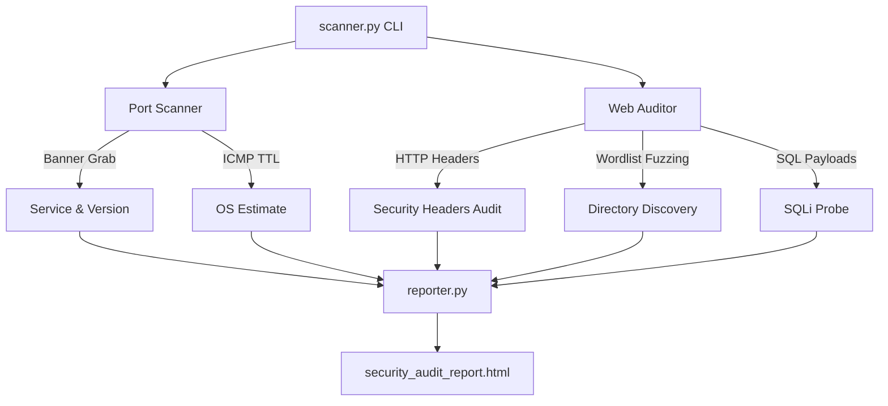

# 🔍 Python Network & Web Vulnerability Auditor

A modular, lightweight Python-powered security CLI that performs active port scanning, service version detection, OS fingerprinting, and OWASP web application checks — compiling findings into a beautiful cyberpunk HTML diagnostic report.


> ⚠ **For authorised security testing only.** Only scan systems you own or have written permission to audit.

---

## ⚡ Core Features

- **⚡ Multi-Threaded Port Scanner**: Audits TCP ports concurrently — scans 1000+ ports in seconds.
- **📡 Service & Version Fingerprinting**: Sends socket probes to read service banners (SSH, FTP, HTTP, MySQL …).
- **🖥 OS Estimation**: Reads ICMP TTL values to guess Linux, Windows, or network device.
- **🛡 OWASP Security Header Evaluator**: Flags missing `Content-Security-Policy`, `HSTS`, `X-Frame-Options`, `X-Content-Type-Options`, and more.
- **📂 Directory Fuzzer**: Discovers hidden paths, admin panels, `.env` files, `.git/config`, backups, and API endpoints using a 150+ entry wordlist.
- **💉 SQLi Probe**: Tests query parameters against 10 SQL injection payloads — detects database error patterns.
- **📊 Cyberpunk HTML Report**: Standalone dark-mode audit report with:
  - SVG risk-score gauge (0–100)
  - Interactive filterable tables
  - Colour-coded severity chips
  - Step-by-step remediation guide

---

## 🏗️ Architecture



---

## 📂 Structure

```text
vuln-scanner/
├── scanner.py              # Main CLI entry point
├── requirements.txt        # requests, beautifulsoup4
├── modules/
│   ├── __init__.py
│   ├── port_scanner.py     # Multi-threaded TCP scanner + banner grabber
│   ├── web_auditor.py      # OWASP header audit, dir fuzzing, SQLi probe
│   └── reporter.py         # Standalone HTML report generator
└── wordlists/
    └── common_dirs.txt     # 150+ fuzzing paths
```

---

## 🚀 Quick Start

### 1. Prerequisites
- Python 3.10+
- pip

### 2. Installation

```bash
git clone https://github.com/Rizwancamp007/vuln-scanner.git
cd vuln-scanner
pip install -r requirements.txt
```

### 3. Usage

```bash
# Port scan only (common ports)
python scanner.py --target 192.168.1.1

# Port scan with custom range
python scanner.py --target 192.168.1.1 --ports 1-1024 --threads 100

# Web audit only
python scanner.py --target https://example.com --web-only

# Full scan (ports + web audit) + auto-open report
python scanner.py --target https://example.com --full --open

# Quiet mode (no verbose output)
python scanner.py --target 10.0.0.1 --quiet
```

### 4. All Flags

| Flag | Default | Description |
|------|---------|-------------|
| `--target` | required | Hostname, IP, or URL |
| `--ports` | `common` | Port spec: `common`, `1-1024`, `22,80,443` |
| `--threads` | `80` | Thread pool size |
| `--timeout` | `1.5` | Per-port TCP timeout (seconds) |
| `--full` | off | Run port scan + web audit |
| `--web-only` | off | Skip port scan |
| `--wordlist` | built-in | Custom wordlist path |
| `--output` | `security_audit_report.html` | Report output path |
| `--open` | off | Auto-open report in browser |
| `--quiet` | off | Suppress verbose output |
| `--no-report` | off | Skip HTML report generation |

---

## 🧬 Threat Detection Details

### Security Headers Checked

| Header | Severity |
|--------|----------|
| Content-Security-Policy | CRITICAL |
| Strict-Transport-Security | HIGH |
| X-Frame-Options | HIGH |
| X-Content-Type-Options | MEDIUM |
| Referrer-Policy | LOW |
| Permissions-Policy | LOW |
| X-XSS-Protection | LOW |

### SQLi Payloads Used

```python
payloads = [
  "' OR '1'='1", "' OR 1=1--", "admin'--",
  "' UNION SELECT null,null--", "1; SELECT 1",
  "\" OR \"\"=\"", "1 OR 1=1", ...
]
```

---

## 📄 License

MIT License — see [LICENSE](LICENSE) for details.
